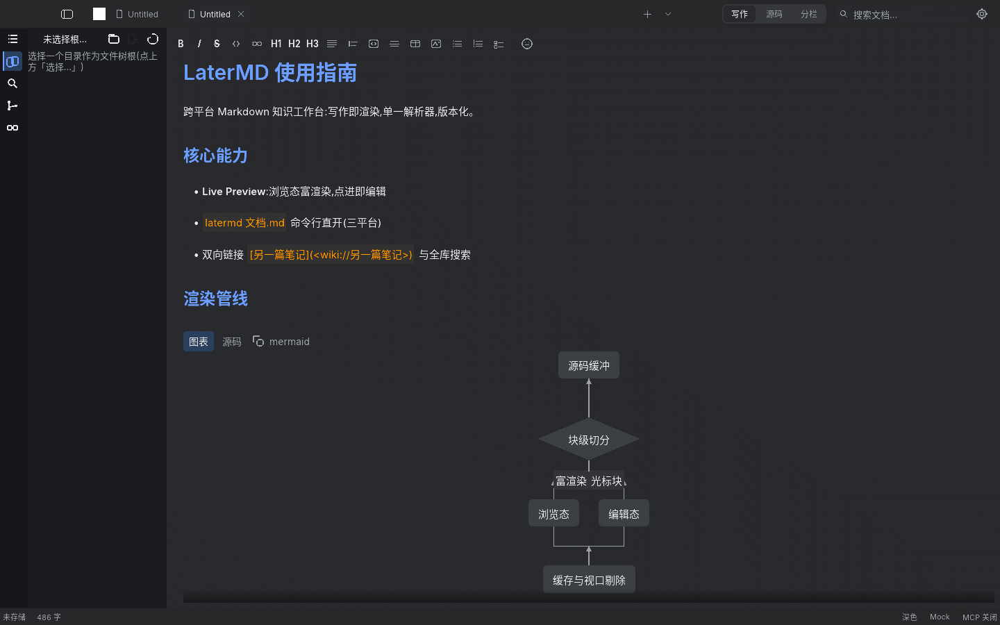
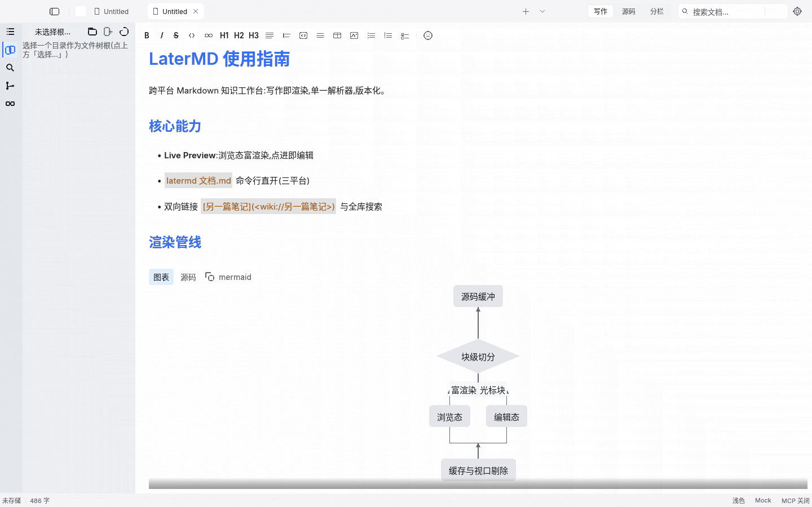
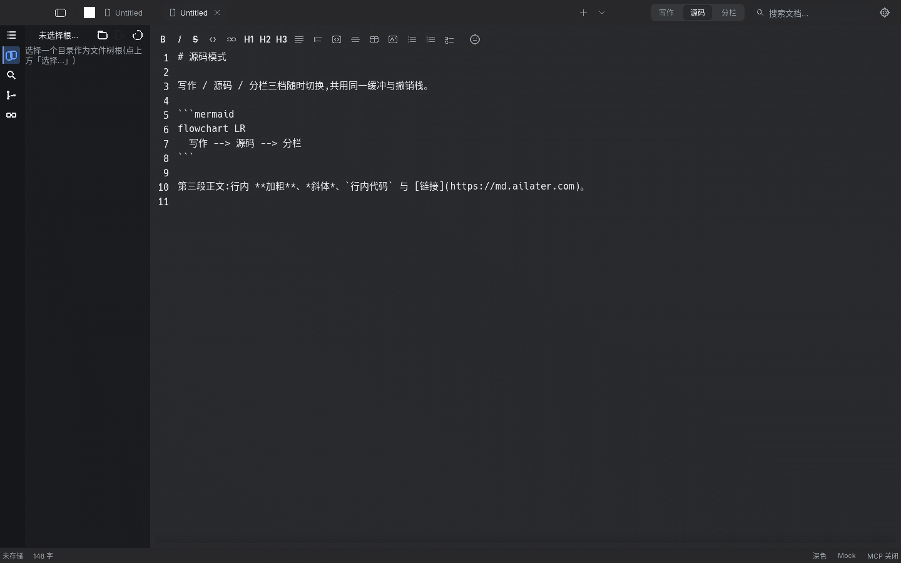

<div align="center">
  
</div>

# LaterMD

[](https://github.com/ailater/LaterMd/actions/workflows/rust.yml)

**跨平台、版本化、可对话、可演化的 Markdown 知识工作台** —— Markdown 是内容层,AI 是智能层,Git 是时间层。

纯 Rust(egui + eframe),Windows / macOS / Linux 三平台原生界面,无 Web 栈。
当前版本 **v0.0.13**(2026-10-27):三态视图(写作 / 源码 / 源码+对照)、搜索替换、AI 流式写作、Git 只读集成与主工作区 diff 审阅、双击 `.md` 文件关联、mermaid 图表预览与图表/源码切换、`latermd` 命令行直开(三平台)均已可用。
技术决策见 [docs/](docs/README.md),演进路线见 [docs/roadmap.md](docs/roadmap.md)。

## 界面截图

| 写作 · 深色(大纲面板) | 写作 · 浅色(大纲面板) |
|:---:|:---:|
|  |  |

源码模式(行号 gutter、Markdown 原始标记):



## 功能特性

**编辑与预览**

- 默认进入「写作」；标题栏三段开关在 写作 / 源码 / 源码+对照(分栏) 三档间循环(Ctrl/Cmd+/)；分栏的右栏是同一份文档的**只读** Live 富渲染。支持 CommonMark + GFM，全项目仅 pulldown-cmark 一个解析器
- 三档共用同一缓冲与撤销栈;写作档下撤销按块分段(Ctrl+Z 先撤当前块内的修改,跨块的修改需先把光标移回对应块逐块撤销)
- 多标签编辑,代码块语法高亮与一键复制
- mermaid 图表渲染,块头「图表 / 源码」一键切换;图表态预览只读
- Zed 式汉堡菜单栏:标题栏左缘汉堡展开八个菜单组,Alt+字母 直达;禅定模式、打字机专注、minimap 代码地图、Ctrl+G 行跳转、任务勾选回写、TOC 生成
- 页内查找:Ctrl+F 聚焦查找条,全部命中浅底高亮;搜索替换 VS Code 化(行内匹配高亮、内联全部替换)

**文件与知识管理**

- 新建 / 打开 / 保存 / 另存为,原子落盘
- 文件树:懒加载、`.gitignore` 过滤、当前文件高亮
- 大纲面板:点击跳编辑器光标或预览对应位置
- 侧边栏全文搜索,支持正则
- `[[wikilink]]` 双向链接

**AI 智能层**

- AI 流式写作;未配置 API key 时内置 Mock 演示,开箱可试
- `ai://` 链接协议与 AI 指令块,AI 修改都在 token/AST 层操作
- AI commit message、AI 摘要大纲
- API key 本地加密存取,不进 Git

**版本层**

- Git 只读集成:「更改 / 存储库 / 文件历史」三折叠分区,高度可拖拽调整
- diff 审阅进主工作区(双栏 / 统一视图),历史提交可展开文件级差异;blame 与单文件回滚

**外观与配置**

- 浅色 / 深色 / 跟随系统三态主题，10 套整应用皮肤（含「青竹护眼」），Windows / macOS / Linux 共用；[皮肤配置与跨平台迁移](docs/workbench-skins.md)
- 标准 / 紧凑界面密度,快捷键可改绑,设置持久化

**导出与集成**

- HTML 导出,单文件内嵌样式
- 内置 MCP 服务器:五个只读工具,stdio / HTTP 双通道;默认关闭,开启后仅绑定 `127.0.0.1`

## 安装

本项目**不做代码签名与公证**(个人开源软件),各平台安装方式:

| 平台 | 方式 |
|---|---|
| macOS(推荐) | `brew install --cask crazykun/ailater/latermd`(cask 经 postflight 自动移除 quarantine,无 Gatekeeper 拦截) |
| Windows | 三选一:安装器 `latermd-{版本}-setup.exe`(向导式,按用户装、无 UAC);绿色版 `latermd.exe` 直接运行;或 `latermd-x86_64-pc-windows-msvc.zip` 归档版 |
| Linux | 下 `latermd-x86_64-unknown-linux-gnu.tar.xz`,解包后 `./latermd` |

- macOS 走 brew 的用户无额外步骤;**从 Releases 直下 dmg** 的用户,拖入 `/Applications/` 后首次打开会被 Gatekeeper 拦(无签名公证的正常表现),执行一次即可:

  ```bash
  sudo xattr -dr com.apple.quarantine /Applications/LaterMD.app
  ```

- macOS 的 dmg 为 universal2 双架构(Intel / Apple Silicon 通用)。
- **brew 拿不到新版本时**:cask 版本由发布流水线自动跟版(发版后回填;凭据未配置时由 tap 侧每小时任务兜底),可能有短暂延迟。急用可直接从 [Releases](https://github.com/ailater/LaterMd/releases/latest) 下载 macOS universal2 dmg 安装(资产名以 Release 页为准),拖入 `/Applications/` 后按上条执行一次 `xattr` 即可。
- Windows 无签名直下会触发 SmartScreen,点「更多信息 → 仍要运行」,不视为缺陷。

### 关联 .md 文件(双击直接打开)

安装后 LaterMD 支持双击 `.md` / `.markdown` 直接打开,也可以从命令行开:`latermd 路径/文件.md`。已在运行时再双击会**开进当前窗口的新标签**,不另起进程。

安装包只把 LaterMD **加进候选列表,不抢默认打开程序**(避免顶掉你原有的编辑器)。要设为默认:

| 平台 | 操作 |
|---|---|
| Windows | 安装向导里勾「Associate .md and .markdown files with LaterMD」;要改默认,到「设置 → 应用 → 默认应用」里选 LaterMD |
| macOS | Finder 里选中 `.md` → 右键「打开方式 → 其它 → 全部更改… → 选 LaterMD」 |
| Linux | `xdg-mime default latermd.desktop text/markdown`,或在文件管理器里右键 → 打开方式 → 其它应用 → 设为默认 |

命令行:

```bash
latermd ~/notes/todo.md     # 打开单个文件
latermd ~/notes/*.md        # 多个文件各开一个标签
```

## 平台支持

| 平台 | 支持 | 图形后端 |
|---|---|---|
| Windows 11+ (x64 / ARM64) | ✅ | DX12 (wgpu) |
| macOS 14+ (Sonoma) | ✅ | Metal (wgpu) |
| Linux (X11 / Wayland) | ✅ | Vulkan (wgpu) |

**显式不支持 Windows 10(含 LTSC)与 macOS 13 及以下。**

Linux **原生支持 Wayland 与 X11 两种会话**(winit 启动时自动选择;Wayland 会话下是原生客户端,不经 XWayland)。需要强制时设 `WINIT_UNIX_BACKEND=x11`(或 `wayland`)。

驱动黑名单逃生口:`LATERMD_RENDERER=glow` 环境变量可切换渲染后端(仅诊断用)。

## 自动发版

发版 = 在 PR 里把 `Cargo.toml` 的 `workspace.package.version` 提到新版本号(同 PR 在 [CHANGELOG.md](CHANGELOG.md) 加对应小节,它会成为 Release 正文)。合入 `main` 且门禁([Rust](.github/workflows/rust.yml))跑绿后,[auto-tag](.github/workflows/auto-tag.yml) 自动打 tag 并触发 [Release](.github/workflows/release.yml):五目标构建(Linux x64、macOS 双架构、Windows x64 + ARM64)→ 创建 GitHub Release → 合成 macOS universal2 dmg。版本号不变地合入不会重复发版。

发布操作细节与资产核对清单见 [docs/distribution.md](docs/distribution.md)。

## 技术栈

纯 Rust。核心选型(完整清单与版本见 [docs/adr-004](docs/adr-004-technical-stack.md)):

- **GUI**:egui + eframe 0.36.2(wgpu 后端)
- **Markdown**:pulldown-cmark —— 全项目唯一解析器
- **渲染**:vendored [egui_markdown](https://github.com/membrane-io/egui_markdown)(升级至 egui 0.36.2)
- **版本层**:git2(只读集成)
- **打包**:axodotdev/cargo-dist,三平台 CI 矩阵

## 范围

按优先级:P0 编辑器骨架 → P1 AI 流式写作 → P2 Git 只读集成 → P3 Live Preview 与双向链接。明细见 [roadmap](docs/roadmap.md)。

**明确不做(不是「以后做」,是不属于本产品)**:

- True WYSIWYG(Word / Notion 形态)—— `.md` 文件永远是真相源
- 知识图谱、语义搜索、MOC、多模态嵌入 —— 这是另一个产品
- Git 的 rebase / cherry-pick / LFS / submodule / 多仓库
- 小说助手、闪卡、日记洞察

> 判断标准:如果一项功能不能让「写下一篇技术文档」变得更快,它就不在 P0–P2。

## 从源码构建

| 项 | 要求 |
|---|---|
| Rust | **1.98.0**(根目录 `rust-toolchain.toml` 已钉死,rustup 自动切换) |
| Linux 额外依赖 | `sudo apt-get install -y libxkbcommon-dev` |
| 图形环境 | Linux 需 X11 / Wayland 会话 |

```bash
cargo run --release -p latermd-app     # 编译并直接运行
./target/release/latermd               # 跑已编译好的产物
```

三平台命令一致(Windows 需 MSVC 生成工具),产物不能跨平台拷贝。
CJK 字体(微软雅黑 / 苹方 / Noto Sans CJK)已按平台内置候选,中文开箱可用。

macOS 开发建议通过 `.app` 启动，与发布版使用相同的应用包结构：

```bash
bash packaging/macos/build.sh --open                  # 本机架构 debug .app
bash packaging/macos/build.sh --release --universal --dmg  # 双架构 .app 与 dmg
```

产物位于 Cargo target 目录的 `macos/` 下。脚本复用现有图标和 Info.plist，
执行 ad-hoc 签名及校验；不安装到 `/Applications`，不发布 Release。
环境要求及验证记录见 [macOS 开发文档](docs/macos-development.md)。

## 开发

分支与推送规则、vendor 改动三类拆分、三条铁律与合入门禁,见 [AGENTS.md](AGENTS.md)(所有贡献者与 Agent 必读)。

## License

[MIT](LICENSE)
